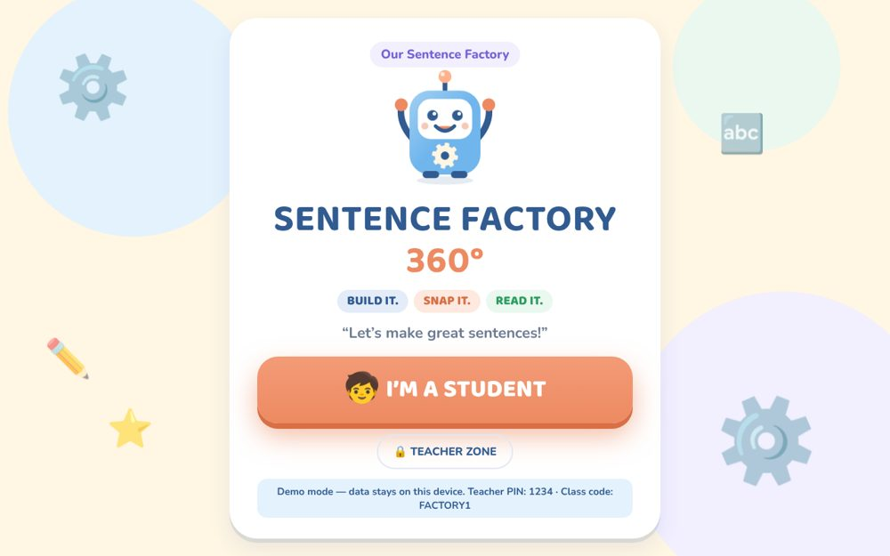
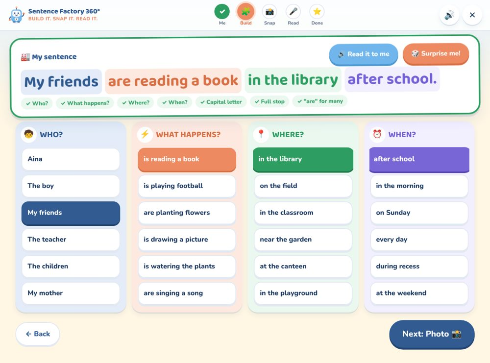
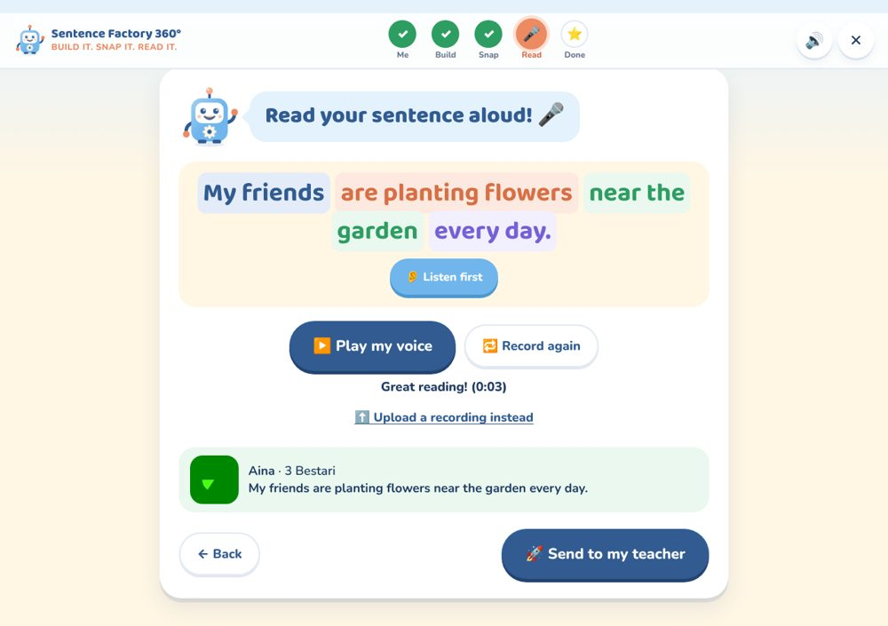
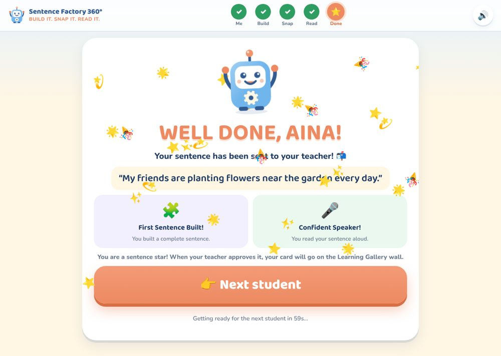
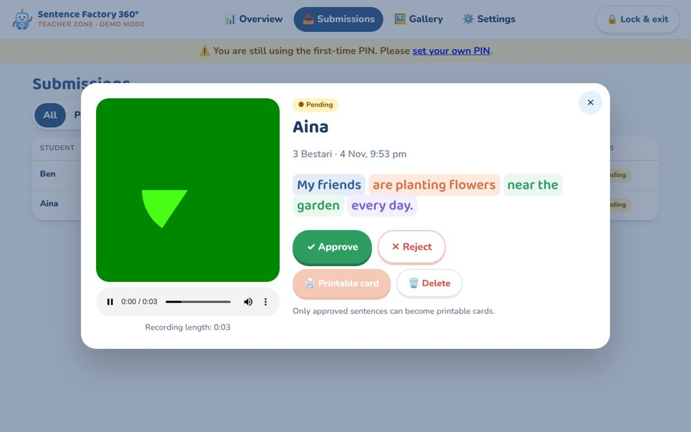
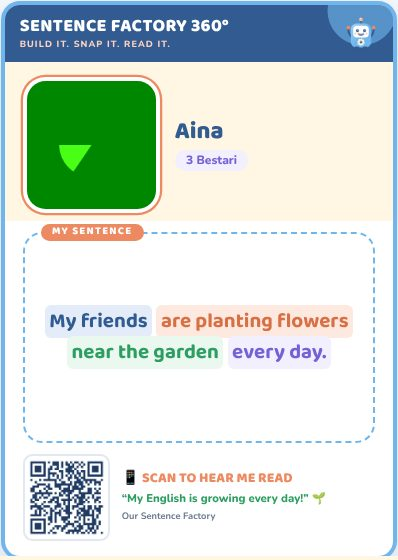
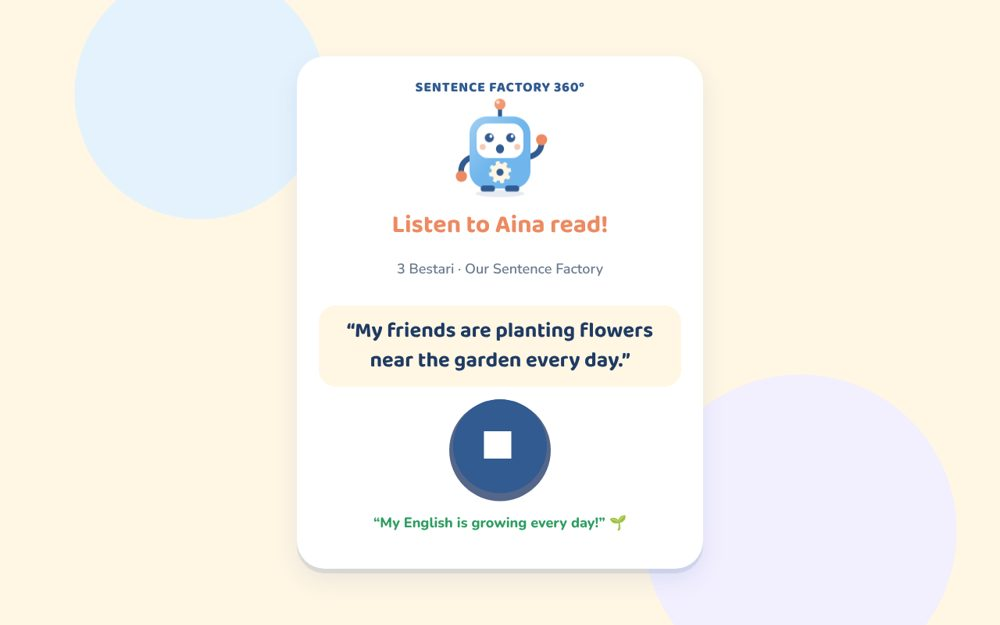

# Sentence Factory 360°

**BUILD IT. SNAP IT. READ IT.**

A tablet learning station for Year 3 English, for **one teacher or a whole school**. Pupils build a sentence from **WHO? · WHAT HAPPENS? · WHERE? · WHEN?** cards, take a selfie, and record themselves reading it aloud. The teacher reviews each submission, approves it, and prints an **A6 learning card** with a QR code that plays the child's voice. The cards go up on the classroom Learning Gallery wall.

> **Every child can build a sentence. Every child deserves to be heard.**

| Welcome | Build | Read aloud |
|---|---|---|
|  |  |  |

| Well done! | Teacher review | A6 card | QR → listen page |
|---|---|---|---|
|  |  |  |  |

*(The green square in the screenshots is the test camera's picture, not a real photo.)*

---

## Contents

1. [What it does](#1-what-it-does)
2. [Try it right now (demo mode)](#2-try-it-right-now-demo-mode)
3. [How it is built](#3-how-it-is-built)
4. [Set up Supabase](#4-set-up-supabase-backend)
5. [Deploy to Netlify](#5-deploy-to-netlify-frontend)
6. [First-day setup: class code and teacher PIN](#6-first-day-setup-class-code-and-teacher-pin)
7. [Using it in class](#7-using-it-in-class)
8. [Printing the cards](#8-printing-the-a6-cards)
9. [Security and privacy](#9-security-and-privacy)
10. [Troubleshooting](#10-troubleshooting)
11. [Project files](#11-project-files)

A step-by-step testing checklist is in **[TESTING.md](TESTING.md)**.

---

## 1. What it does

### Pupils (no accounts, no passwords)
1. **Welcome**: a big "I'M A STUDENT" button, and a smaller "Teacher Zone" button.
2. **Me**: the pupil types their name, taps their class (shown with the teacher's name and photo) and enters the classroom code. The code unlocks that teacher's word bank.
3. **Build**: four colour-coded word columns. The sentence appears in a large preview as the pupil taps cards.
   - 🔊 *Read it to me* (text-to-speech). Each word is also read aloud when tapped.
   - 🎲 *Surprise me!* builds a random sentence that is always grammatically correct.
   - ✅ **Sentence Quality Checker**: shows ticks for each part, the capital letter, the full stop and **is/are agreement**. "My friends is…" gets a friendly hint and a one-tap **Fix it for me** button.
   - Pupils can't move on while a part is missing. The missing column shakes and Gizmo the robot says what's needed.
   - Factory-style sound effects play as each part drops in.
4. **Snap**: front camera with a 3-2-1 countdown, retake/remove, and an **upload a photo** fallback. Photos are square-cropped and shrunk to about 60–100 KB.
5. **Read**: big record button, live voice-level meter, 30-second limit, playback, record again, and an **upload a recording** fallback. A *Listen first* button models the reading.
6. **Done**: "WELL DONE, AINA!" with confetti and encouraging badges (*First Sentence Built!*, *Confident Speaker!*, *Sentence Superstar!*, *Creative Word Builder!*). The badges never rank or compare children.
   - Everything about that pupil (name, code, photo, voice) is **wiped** before the next child starts. This happens when they tap *Next student*, after 60 seconds, or after 4 minutes of no activity.

### Teachers (each with their own profile, classes and pupils)
- **Sign-up with a school code.** New teachers register on the Teacher Zone screen using the **school code** set by the admin. The very first teacher uses the setup code (the `INITIAL_TEACHER_PIN` secret) and becomes the **school admin**.
- **Tap your name + PIN.** The login screen lists every teacher with their photo. Each teacher has their own 4–8 digit PIN.
- **Profile:** title (Teacher / Cikgu / Puan…), name, school, subject, photo and a welcome message. Pupils see the name and photo when they pick their class, the welcome message on the build screen, and "sent to Cikgu Ali!" when they finish. The name, school and subject are printed on the A6 cards.
- **Kept separate:** each teacher has their own classes and access codes, word bank, Word of the Day, Challenge, photo-required setting, submissions, gallery and cards. A teacher can never see another teacher's pupils.
- **School admin** (Settings → School): sets the school name and school code, sees all teachers, resets a forgotten PIN, makes another teacher admin, or removes a teacher. Removing a teacher deletes their classes and all their pupils' photos and recordings.

### Teacher Zone (PIN protected, checked on the server)
- **Overview**: total / pending / approved / rejected counts, plus a "waiting for you" list that refreshes every 20 seconds.
- **Submissions**: filter by All / Pending / Approved / Rejected and by class, and search. Opening a submission shows the photo, sentence and audio player. Buttons: **Approve**, **Reject**, **Approve & next**, back to pending, delete.
- **Printable A6 card** (approved only): Print, or Download PDF. **Print all cards** for a class in one go.
- **Digital Learning Gallery**: approved cards with photo, sentence and audio, filterable by class.
- **Settings** (tabs): My profile · My classes & codes (+ photo required on/off) · Word bank (add/remove, mark WHO words as "more than one") · **Word of the Day** · **Sentence Challenge** (with presets) · My PIN · **School** (admin only).
- The Teacher Zone locks itself after 15 minutes of no use. Sessions last 8 hours at most.

---

## 2. Try it right now (demo mode)

Demo mode runs the **whole app in the browser with no Supabase**. Data is kept in the browser's own storage (IndexedDB) on that one device. Use it to explore, train colleagues or test.

```bash
npm install
npm run dev:demo          # open http://localhost:5173
```

- Teacher: **Teacher Rina** (admin), PIN **1234** · Class: **3 Bestari**, code **FACTORY1**
- Try signing up a second teacher with school code **SCHOOL1**
- The camera and microphone work on `localhost`. On any other address they need **HTTPS**.

To put demo mode on Netlify (for a trial, not real pupils), set the environment variable `VITE_DEMO_MODE=true`.

---

## 3. How it is built

```
 Tablet (Chrome)                     Supabase
┌──────────────────────┐   HTTPS   ┌─────────────────────────────────────────┐
│ React + TypeScript   │ ────────► │ Edge Functions (Deno, service-role key) │
│ (Vite, Netlify)      │           │  • student  – config, code check, upload │
│                      │           │  • teacher  – PIN login + all admin      │
│ Uses ONLY the public │           │  • listen   – QR → fresh audio link      │
│ anon/publishable key │           │                │                         │
└──────────────────────┘           │   PostgreSQL (RLS on, no browser access) │
                                   │   Storage bucket "submissions" (PRIVATE) │
                                   └─────────────────────────────────────────┘
```

- **Frontend:** React 19, TypeScript, Vite, hand-written CSS (no UI framework), `react-router-dom`, `qrcode`, `jspdf` + `html2canvas` (only loaded when making a PDF). Fonts are bundled, so nothing loads from Google.
- **Backend:** Supabase PostgreSQL, Storage and Edge Functions. The browser **never talks to the database directly**. Every table has Row Level Security turned on with **no policies**, and all privileges are revoked from the `anon`/`authenticated` roles.
- **Hosting:** Netlify (`netlify.toml` includes the single-page-app redirect and camera/microphone permission headers).

---

## 4. Set up Supabase (backend)

You need: a free [Supabase](https://supabase.com) account, [Node.js 20+](https://nodejs.org), and the [Supabase CLI](https://supabase.com/docs/guides/cli) (`npm i -g supabase`, or `brew install supabase/tap/supabase`).

### 4.1 Create the project
1. In the Supabase dashboard, click **New project**. Pick a region close to Malaysia (e.g. *Southeast Asia (Singapore)*) and save the database password.
2. Open **Project Settings → API** and copy:
   - **Project URL** (e.g. `https://abcd1234.supabase.co`)
   - **anon / publishable key** (the public one)
   - ⚠️ Do **not** copy the `service_role` / secret key into any frontend file. The Edge Functions get it automatically.

### 4.2 Create the tables and storage bucket
From the project folder:

```bash
supabase login
supabase link --project-ref YOUR-PROJECT-REF      # the "abcd1234" part of the URL
supabase db push                                   # runs supabase/migrations/*.sql
```

*No CLI?* Open **SQL Editor → New query**, paste the whole of the first migration file and click **Run**, then do the same with the second. Both are safe to run more than once.

There are **two** migration files and they must both run, in order: `20261104000000_sentence_factory.sql`, then `20261105000000_multi_teacher.sql`. `supabase db push` does this for you. In the SQL Editor, paste and run them one after the other.

Together they create the `app_settings`, `teachers`, `classes`, `word_bank`, `submissions` and `login_attempts` tables. It also creates the **private** storage bucket `submissions` (6 MB per file) and seeds the school's default word bank (copied to each new teacher) plus one class (**3 Bestari**, code **FACTORY1**). That class belongs to whoever signs up first.

### 4.3 Set the server secrets
```bash
cp supabase/functions/.env.example supabase/functions/.env
```
Edit `supabase/functions/.env`:

| Secret | What to put |
|---|---|
| `INITIAL_TEACHER_PIN` | A 4–8 digit **setup code** (e.g. `583921`). The first teacher types it as the "school code" to create the admin account. It stays the school code until the admin sets a new one. |
| `TEACHER_SESSION_SECRET` | A long random string. Generate one with `openssl rand -hex 32`. |
| `ALLOWED_ORIGINS` | Your site address(es), comma-separated, e.g. `https://sentence-factory.netlify.app,http://localhost:5173`. |

Then upload them:
```bash
supabase secrets set --env-file supabase/functions/.env
```
(Or set them in **Dashboard → Edge Functions → Secrets**.)

### 4.4 Deploy the Edge Functions

> **No command line?** Use the ready-to-paste single files in [`supabase/dashboard-paste/`](supabase/dashboard-paste/README.md) with the dashboard's **Deploy a new function → Via Editor**, then turn **Enforce JWT verification** off for each.

With the CLI:
```bash
supabase functions deploy student --no-verify-jwt
supabase functions deploy teacher --no-verify-jwt
supabase functions deploy listen  --no-verify-jwt
```
`--no-verify-jwt` is needed because these functions do their own checks: the classroom code for pupils, the signed PIN session for teachers, and the random QR token for listeners. It also lets the newer publishable keys work. `supabase/config.toml` sets the same thing.

Check it works:
```bash
curl -s -X POST https://YOUR-PROJECT-REF.supabase.co/functions/v1/student \
  -H "apikey: YOUR-ANON-KEY" -H "Content-Type: application/json" -d '{"action":"config"}'
```
You should see JSON with `classes` and `words`.

---

## 5. Deploy to Netlify (frontend)

### Option A: from GitHub (recommended)
1. Push this folder to a GitHub repository. `.gitignore` already excludes `.env` files and `node_modules`.
2. In Netlify, go to **Add new site → Import an existing project** and pick the repo. The build settings come from `netlify.toml` (`npm run build`, publish `dist`).
3. Under **Site configuration → Environment variables**, add:

   | Key | Value |
   |---|---|
   | `VITE_SUPABASE_URL` | your Project URL |
   | `VITE_SUPABASE_ANON_KEY` | your anon / publishable key |
   | `VITE_PUBLIC_SITE_URL` | your final site address, e.g. `https://sentence-factory.netlify.app` (printed in QR codes) |

4. **Deploys → Trigger deploy**.
5. Put the final Netlify address into `ALLOWED_ORIGINS` (step 4.3) and run `supabase secrets set` again.

### Option B: from your computer
```bash
cp .env.example .env        # fill in the three values
npm install
npm run build
npx netlify-cli deploy --prod --dir=dist
```

> 💡 **Set `VITE_PUBLIC_SITE_URL` before you print cards.** The QR codes contain this address. If you later move to a custom domain, keep the old Netlify address working (Netlify does this automatically) so printed cards still scan.

Netlify gives you HTTPS automatically. Browsers need HTTPS for the camera and microphone.

---

## 6. First-day setup: class code and teacher PIN

**The first teacher (the school admin):**
1. Open the site on the classroom tablet (Chrome) and tap **Teacher Zone**. Because nobody has signed up yet, you'll see **"Set up the first teacher"**.
2. For **School code**, type your `INITIAL_TEACHER_PIN`. Then fill in your title, name, school and subject, and choose **your own PIN**. You are now the school admin. Any class or submission created before teachers existed (e.g. the seeded *3 Bestari / FACTORY1*) now belongs to you.
3. **Settings → School**: set a **school code** of your own (🎲 *Make code*) and give it to colleagues. From then on, `INITIAL_TEACHER_PIN` no longer works for signing up.
4. **Settings → My profile**: add your photo and a welcome message for your pupils.
5. **Settings → My classes**: rename *3 Bestari*, change **FACTORY1**, or add your classes. Each class has its own access code.
6. **Settings → Word bank / Word of the Day / Challenge**: make them your own. Tick *more than one* for plural WHO words (e.g. *The cats*).
7. Tap **🔒 Lock & exit** before handing the tablet to pupils.

**Other teachers:** Teacher Zone → **New teacher? Sign up**. Enter the school code from the admin, then your profile and PIN. Each new teacher starts with a copy of the default word bank and no classes, then adds their own classes in **Settings → My classes**.

**Forgotten PIN:** the admin opens **Settings → School → 🔑 Reset PIN** next to that teacher. If the only admin forgets their PIN, run this in the Supabase SQL Editor: `update teachers set pin_hash = null where name = 'Rina';`. They can then log in once with `INITIAL_TEACHER_PIN` as their PIN, and should set a new one in **Settings → My PIN**.

**Tablet tips:** In Chrome, open the site, then go to **⋮ → Add to Home screen** for a full-screen app icon. Allow camera and microphone the first time Chrome asks. Turn the volume up, and consider Android **screen pinning** so pupils stay in the app.

---

## 7. Using it in class

- Pupils take turns. The tablet shows the Welcome screen between pupils.
- You can review on the same tablet (Teacher Zone), or on your own laptop or phone at the same address. *Approve & next* moves through 30 pupils quickly.
- **Rejected** isn't a judgement the child sees. It just keeps that attempt off the wall. Let the pupil try again.
- If the Wi-Fi drops, a banner appears. The pupil's work stays on screen, and *Try again* resends it. Each submission has a unique id, so retries and double taps never create duplicates.

---

## 8. Printing the A6 cards

Single card: **Submissions → open → 🖨️ Printable card**. A whole class: **Gallery → 🖨️ Print all cards**.

- **Print**: choose paper **A6** (105 × 148 mm), margins **None**, and turn on **Background graphics**. On A4 paper, use your printer's "4 per sheet / multiple pages per sheet" option, or "Fit to page".
- **Download PDF**: one A6 page per card. If a photo is missing from the PDF, use **Print → Save as PDF** instead.
- The QR code opens `/listen/<token>`. The token is a long random code, **not** an expiring link. Each scan gets a fresh 30-minute audio link from the server, so **printed cards keep working for as long as the submission stays approved**. To switch off a card's QR code, reject or delete it.

---

## 9. Security and privacy

| Requirement | How it's met |
|---|---|
| Teacher PIN checked on the server | `teacher` function. Each teacher's PIN is stored as a PBKDF2-SHA256 (150k iterations) hash, compared in constant time. PINs are never in frontend code. |
| Teachers kept apart | Every teacher query on the server is filtered by the signed-in teacher's id. Opening, approving or deleting another teacher's submission returns "not found". Admin-only actions return 403 for other teachers. *(Verified by 62 automated checks against a real database.)* |
| Sign-up | Needs the school code, which counts towards the same lockout as wrong PINs. Duplicate teacher names are refused. |
| Brute-force protection | After 8 wrong PINs from one address, or 40 overall, in 15 minutes → locked for 15 minutes. |
| Teacher session | HMAC-signed token (8 h) naming one teacher, kept in `sessionStorage`. Auto-lock after 15 minutes idle. A PIN change or admin reset signs that teacher out everywhere. A removed teacher is signed out at once. |
| Service-role key never in the browser | Only the Edge Functions use it (provided by Supabase). The frontend uses the public anon key. |
| RLS / no direct table access | RLS on every table, no policies, privileges revoked from `anon`/`authenticated`. *(Verified: `select` as `anon` → "permission denied".)* |
| Classroom code validated | `student` function checks the code for every verify and **every submission**. |
| Pupils can't see others' work | The student endpoint has no "read submissions" action at all. The class list shows names only. Access codes are never sent to the tablet, and a class's words are only returned after its code is entered. |
| Input validation | The server rebuilds the sentence itself and only accepts word-bank phrases (or their is/are-fixed form). Names are cleaned. File types and sizes are checked. |
| Private media | Bucket `submissions` is private. The dashboard uses 1-hour signed URLs. The QR page gets a fresh 30-minute signed URL per scan, and only for **approved** work. |
| Listen page | Shows the pupil's name, class, sentence and voice. **No photo** (the card on the wall already has it). |

**Privacy (PDPA 2010).** You are collecting children's names, faces and voices. Follow your school's consent and retention rules. Use *Photo is required → off* where photo consent isn't given. At the end of the year, **delete** submissions (Teacher Zone → delete removes the photo and recording too). Alternatively, empty the `submissions` bucket in **Storage** and run `delete from submissions;` in the SQL Editor.

---

## 10. Troubleshooting

| Problem | Fix |
|---|---|
| "Setup needed: add your Supabase details" | `VITE_SUPABASE_URL` / `VITE_SUPABASE_ANON_KEY` are missing in Netlify. Add them and redeploy. |
| "Failed to fetch" / CORS errors | Add your exact site address (with `https://`, no trailing `/`) to `ALLOWED_ORIGINS`, then run `supabase secrets set` again. |
| "Could not find the table 'public.teachers'" | The second migration hasn't been run. Run `20261105000000_multi_teacher.sql` in the SQL Editor. |
| "INITIAL_TEACHER_PIN is not configured" / "TEACHER_SESSION_SECRET is not configured" | Set the secrets (4.3). The PIN must be 4–8 digits. The secret must be 24+ characters. |
| 401 "Invalid JWT" from functions | They were deployed without `--no-verify-jwt`. Deploy again with it. |
| Camera / microphone won't start | The site must be **HTTPS**. Check Chrome **⋮ → Settings → Site settings → Camera/Microphone** for the site. Close other apps using the camera. Pupils can still use *Upload*. |
| No read-aloud voice | Install an English voice: Android **Settings → Text-to-speech → Google**, add English (UK). |
| Recording plays on Android but not iPhone | iOS Safari records MP4/AAC, which the app supports. Make sure iOS is up to date. |
| Printed card's QR says "not found" | The submission was rejected or deleted, or `VITE_PUBLIC_SITE_URL` pointed at an old address when the card was printed. |

---

## 11. Project files

```
sentence-factory-360/
├─ index.html, vite.config.ts, tsconfig.json, package.json
├─ netlify.toml                  SPA redirect + camera/mic permission headers
├─ .env.example                  frontend variables (Netlify)
├─ .env.demo                     enables demo mode for `npm run dev:demo`
├─ public/favicon.svg
├─ src/
│  ├─ main.tsx                   routes: /  /teacher/*  /listen/:token
│  ├─ styles.css, card.css       app styles; A6 card + print styles
│  ├─ api/                       supabaseApi (Edge Functions), demoApi (IndexedDB), types
│  ├─ lib/                       sentence logic & checker, sounds, speech, media, QR, PDF
│  ├─ components/                Gizmo mascot, SentenceCard (A6), shared UI
│  ├─ student/                   Welcome, Identify, Build, Photo, Voice, Success
│  ├─ teacher/                   PinLogin (pick name + PIN, sign-up), Overview, Submissions, ReviewModal, Gallery, CardPage, Settings (profile, classes, words, school admin)
│  └─ pages/Listen.tsx           public QR playback page
└─ supabase/
   ├─ config.toml                functions: verify_jwt = false
   ├─ migrations/…sql            ① tables, RLS lockdown, private bucket, seed data  ② teachers + per-teacher data
   ├─ dashboard-paste/*.ts       single-file functions for the dashboard editor (generated)
   ├─ build-dashboard-paste.py   regenerates dashboard-paste/ after editing functions/
   └─ functions/
      ├─ _shared/util.ts         CORS, admin client, PIN hashing, signed sessions
      ├─ _shared/sentence.ts     same sentence logic as the browser (keep in sync)
      ├─ _shared/util_test.ts    `deno test --allow-env supabase/functions/_shared/`
      ├─ student/index.ts
      ├─ teacher/index.ts
      └─ listen/index.ts
```

**Scripts:** `npm run dev` (needs `.env`), `npm run dev:demo`, `npm run build`, `npm run build:demo`, `npm run preview`, `npm run typecheck`.
